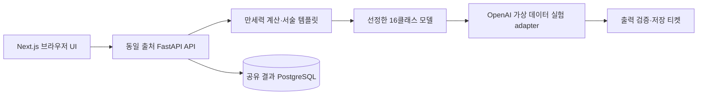

# 러브코드 테크스펙

> 2026-10-13 정리: 저장·공유·삭제 백엔드, PostgreSQL 및 서명 티켓을 완전히 제거했습니다. 아래의 해당 기능 설명은 과거 설계 이력이며 현재 구현 범위가 아닙니다.
>
> 2026-10-15 무저장 공유 링크: 실제 분석 응답에 `share_code`(공개 결과를 raw deflate로 압축하고 `LC_SHARE_SECRET`으로 HMAC-SHA256 서명, 128비트)를 담습니다. 링크는 `/r#코드`이며, 화면은 코드를 `X-Share-Code` 헤더로 `GET /api/v1/shared`에 보내 서명 검증·압축 해제(16 KB 상한)·PublicResult 재검증을 받습니다. 서버·DB에 아무것도 저장하지 않으므로 회수·만료·삭제가 없고, 비밀값을 바꾸면 기존 링크가 모두 무효가 됩니다. 아래 저장형 공유 설계는 여전히 이력입니다. 현재 실행과 코드 탐색은 [README](../README.md)와 [CODE_GUIDE](./CODE_GUIDE.md), HTTP 스키마는 [OpenAPI](./api/openapi.json)를 따릅니다.

> **2026-10-11 최신 범위:** 사용자가 배포 사이트의 실제 사용자 요청을 서버 OpenAI 키로 처리하도록 확정했다. 동의한 요청의 파생 사주 정보·MBTI만 전송하며 원문 생년월일시와 성별은 서버에 남긴다. 입력의 DB·로그·학습 저장은 금지한다. 키·모델·두 활성화 플래그가 없으면 비활성이다. 현행 실행 계약은 [API 연결 인계](./API_HANDOFF.md)와 TECH_SPEC §12이며, 이전의 “가상 CLI만/실제 입력 영구 차단” 규칙을 대체한다. AI 초안은 미검수이며 실제 유료 호출·품질 평가는 아직 하지 않았다.
| 항목 | 값 |
| --- | --- |
| Output type / ID | Full technical specification / LC-TECH 0.1 |
| Governing PRD | [LC-PRD 0.1](./PRD.md) |
| 범위 | 과제·발표용 Next.js / FastAPI / 분류·해설 / 선택 저장·공유·삭제 |
| Completeness | complete for declared scope — 설계 계약·검증 계획 정의 |
| 현재 제외 | 유료 API 실행, 실제 모델 학습·해설 평가, 공개 운영·법률 검토, 배포 |
| Evidence cutoff | 2026-10-11, Asia/Seoul |
| Approval | 4개 제품 선택은 사용자 확정. 아래 구현 기본안은 검토 가능한 초안 |
| 책임 | 프로젝트 팀. 구현·데이터·QA·시연 운영 실명 담당자는 배정 전 |
| UI handoff | [디자인 시스템](./DESIGN_SYSTEM.md), 서면 설계 완료·실행 UI 없음 |
| Specification readiness | Conditionally Ready |
| Release verdict | Not assessed |

## 1. 근거·제안·변경 사항

| 구분 | 근거 | 설계에 반영한 내용 |
| --- | --- | --- |
| 확인 | 노션 제안서 (내부 자료), 2026-10-11 Aside 열람 | 입력 범위, 단일 16유형, LangChain·FastAPI, 비교 실험, 개인정보 원칙 |
| 확인 | 사용자 `1A / 2A / 3B / 4C` | 과제 MVP, 따뜻한 UI, Next.js, 서버 저장·공유 |
| 확인 | 빈 작업공간, [조사 기록](./README.md#문서-검증-기록) | 기존 인프라·모델·테스트를 전제하지 않음 |
| 제안 | D-01 | PostgreSQL 단일 결과 저장소, 캐시·작업 큐·회원 시스템 없음 |
| 제안 | D-02 | 분석 후 사용자가 선택할 때만 저장, 7일 보관, 읽기·삭제 capability 분리 |
| 사용자 확정 | D-03 (개정) | 로컬 생성 제외. 서버 OpenAI로 동의한 실제 요청 처리, 별도 가상 CSV 라벨링·학습 |
| 제안 | D-04 | 저장 티켓 10분, UTC 저장·KST 표시, 고정 UTC+09:00 계산 |

7일·10분 등은 이 MVP의 제안값이며 사용자 승인된 기존 정책이나 법정 기간이 아니다. 이 문서가 세부 기본안의 검토 대상이다. 삭제 예외의 정책 결정 책임은 프로젝트 팀이며 공개 서비스 활성화 승인은 포함하지 않는다.

### 공식 자료 확인

웹 리서치의 quick lookup으로 필요한 동작만 확인했다. 원문이나 개인 컨텍스트는 외부 검색에 보내지 않았다. 2026-10-11 공개 문서 URL만 웹 조회 도구를 통해 nextjs.org, fastapi.tiangolo.com, w3.org에 요청했다.

| 확인 항목 | 출처·강도 | 설계 영향 |
| --- | --- | --- |
| Next.js 캐시 방식은 설정에 따라 달라짐 | [캐시 가이드](https://nextjs.org/docs/app/guides/caching-without-cache-components), verified, 2026-10-11 | 기본 동작을 믿지 않고 결과 경로의 HTTP·앱 캐시를 명시적으로 끔 |
| FastAPI OpenAPI 경로 설정 가능 | [Metadata and Docs URLs](https://fastapi.tiangolo.com/tutorial/metadata/), verified, 2026-10-11 | `/api/v1/openapi.json`을 구현 시 생성 |
| 일반 텍스트 대비 4.5:1, 큰 글자 3:1 | [W3C Quick Reference](https://www.w3.org/WAI/WCAG22/quickref/), verified, 2026-10-11 | 디자인 토큰·접근성 인수 기준 |

반대 검토: Next.js 가이드는 현재 조회 URL을 “Previous Model” 문서로 리다이렉트했다. 따라서 특정 버전의 캐시 기본값·route 설정을 보편 규칙으로 기재하지 않는다. 구현 시 버전을 lockfile로 고정하고 빌드한 앱에서 저장 결과가 캐시되지 않는지 검증한다.

## 2. 구조와 책임



브라우저 `/api/v1/*`는 동일 origin의 reverse proxy로 FastAPI에 전달한다. Next.js는 소개·입력·결과·관리 UI를 담당한다. LangChain은 백엔드의 순차 파이프라인 연결에만 사용하며 도구를 자율 호출하는 agent는 만들지 않는다.

| 구성 | 역할·경계 | 제안 구현 |
| --- | --- | --- |
| Next.js App Router + TypeScript | 입력은 client 메모리, `/r`은 공통 껍데기와 클라이언트 조회 | CSS custom properties + CSS Modules, 추가 UI 프레임워크 필수 아님 |
| FastAPI | 검증·분석·서명·저장·조회·삭제의 유일한 권한 경계 | Pydantic 입력·응답 검증 |
| 규칙 모듈 | 달력 계산·근거·표준 텍스트 | 엔진 adapter로 격리, 라이브러리·버전 검증 후 고정 |
| 분류 모듈 | 텍스트 → 16클래스 중 하나 | TF-IDF+LR / 한국어 사전학습 인코더 비교 |
| 생성 adapter | 근거·유형 → 구조화 해설 | OpenAI Responses API, 서버 전용 키·외부 처리 동의·기능 플래그 필요 |
| PostgreSQL | shared_results·audit_events의 원본 저장소 | 트랜잭션·UNIQUE 제약으로 동시성 처리 |
| expiry worker | 만료 payload·tombstone·감사 로그 정리 | 단일 주기 작업, 1분 간격, 재시작 시 재개 |

과제 시연은 단일 애플리케이션 호스트를 기본으로 한다. 실제 호스팅·장비·패키지 버전은 구현 시작 시 manifest와 lockfile에 기록한다. 현재 설치·계약·벤더가 있다는 주장은 하지 않는다. DB/모델 서버는 외부 공개 포트를 갖지 않는다. 기본 비활성에서는 503이며, 활성화·동의 시 서버에서만 OpenAI를 호출한다.

회원·조직·테넌트 엔터티는 없다. 권한은 결과별 무작위 capability로 제한한다. 이벤트 버스·웹훅·메일·외부 발송·vector DB는 N/A다.

## 3. 분석 파이프라인

### 계산 규약

- 달력 입력은 양력, 고정 UTC+09:00이다. 출생지·경도·진태양시·역사적 민간시각 보정은 하지 않는다. UI에도 한국 표준시 기준을 알린다.
- 연주는 입춘의 정확한 경계, 월주는 절입 경계를 사용한다. 경계의 정확한 timestamp는 선정한 엔진과 기준 fixture에서 검증한다. “2월 4일 전체”처럼 날짜 단위로 단순화하지 않는다.
- **제안 규약:** 일주는 00:00에 교체, 23:00~00:59는 자시로 계산한다. 23시 일주 변경을 사용하는 계산기와 차이가 나면 엔진 결함과 규약 차이를 구분한다. 규약을 고정한 뒤에만 정답 fixture를 만든다.
- 생시가 null이면 임의 시각을 부여하지 않는다. 해당 날짜가 절기·입춘 경계일이라 연·월주까지 시각에 따라 달라지면 가능한 기둥들을 후보로 기록하고 확정 관계만 분류 근거로 사용한다. 시주 제외와 경계 불확실성을 결과의 limitations에 표시하며, 생시 모름 자체를 오류로 돌려보내지 않는다. 이 경계 사례도 학습·평가에 포함한다.
- 기준 사례는 약 20명, 입춘·절입 직전/경계/직후, 22:59·23:00·23:59·00:00, 윤일, 생시 모름, 과거 서머타임 대상 연도의 고정 표준시 비교를 포함한다. 과거 민간시각을 자동 보정했다고 주장하지 않는다.
- 팔자·오행·관계 계산과 신강/신약·필요 기운 해석 규칙은 다른 층이다. 후자 규칙이 미검증이면 `unknown`으로 전달하고 모델·LLM이 채워 넣지 않는다. 성별에 따른 대운·부부 역할 해석은 MVP에서 제외한다.

### 실행 순서

1. 요청 스키마·범위 검증. 전체 본문 상한 4 KiB. 알 수 없는 필드 거부.
2. 두 사람을 내부적으로 정렬해 대칭 처리한다. 정렬 키는 날짜·생시(null 표기 포함)·MBTI·gender의 정규화 튜플이며 저장하지 않는다. 원래 A/B 위치와 제한 메시지는 다시 매핑한다.
3. 엔진이 검증된 Fact 목록을 계산한다. 분류 입력은 사실·unknown 구분만 담으며 정답 라벨을 포함하지 않는다.
4. 버전 고정 템플릿으로 서술형 텍스트를 만든다. 학습에서는 여러 표현을 사용하되 같은 커플의 변형은 같은 split에 둔다. 런타임 템플릿 선택은 정규화 입력 기반으로 결정적이다.
5. 선정된 분류 모델이 단일 type_id를 반환한다. 사전에 없는 ID는 실패다. confidence는 내부 디버그 실험에서만 취급하고 사용자에게 궁합 확률로 표시하지 않는다.
6. 사전에서 네 축을 조회한다. 생성 모델에 type_id·네 축·허용 사실 ID와 근거만 주며 사용자 raw 성별·생년월일시를 주지 않는다.
7. 목표 생성 adapter는 `summary`, `strengths`, `adjustments`, `conversation_tip`과 검증용 `evidence_refs`를 반환한다. 각 해석의 fact 참조가 존재하는지 검사한다. evidence_refs는 공개 결과에서 제거한다.
8. 출력 스키마·금지 표현·원본 노출·유형 일치 검사를 통과한 경우에만 PublicResult와 10분 저장 티켓을 반환한다. 요청 중간 데이터는 참조 해제하며 요청 본문·출력을 로깅하지 않는다.

A/B를 바꿔도 type_id는 동일해야 한다. 해설 문장은 생성 특성상 달라질 수 있지만 의미와 제한 정보는 일치해야 한다. 생성 실패·출력 거부 시 임의 유형이나 미리 쓴 가짜 생성 결과로 성공을 가장하지 않는다.

## 4. AI 정책과 실험

### 분류 데이터·선정

[7컬럼 계약](./DATA_SCHEMA.md#7-학습검수용-csv--확정한-7컬럼)을 따른다. 목표 600쌍, 일정상 축소 시 300쌍이며 둘 중 실제 사용 규모를 보고서에 명시한다. 50쌍 파일럿에서 판단 기준을 다듬은 뒤 전체 초안을 LLM으로 만들고 팀이 전수 검수한다. 날짜는 새로운 완료 주장 없이 단계로 관리한다.

동일 인물·같은 커플의 텍스트 변형·A/B 교환본은 동일 그룹이다. 원본 pair manifest로 인물 교차 0을 검증한다. feature는 input_text만 사용한다. pending AI 초안은 명시적 개발 실험 옵션에서만 target으로 허용한다. 일부 표본 50쌍을 제안 독립 라벨링 표본으로 삼고 16유형을 고르게 포함한다. 두 검수자는 상대 라벨·LLM 라벨을 보지 않고 판단하며 Cohen's kappa, 불일치 건수, 최종 조정 사유를 기록한다. 낮은 합의도를 데이터의 한계로 보고하고 유형을 객관적 진실로 표현하지 않는다.

validation Macro-F1 우선, 동률이면 Accuracy, 이후 추론 지연으로 결정한다. test는 후보 선택 후 최종 평가에만 사용한다. 정확도 목표 수치를 사후에 만들지 않는다. 모든 분류기가 입력과 무관하게 한 유형만 반환하는 등 학습 실패가 확인되면 결과 기능을 비활성화한다.

### 해설 모델 비교·선정

- OpenAI 모델의 exact model ID, 분류 인코더 revision, 실행 장비, 생성 설정, prompt_version, 라이선스/사용 조건 확인을 실험 manifest에 남긴다. 현재 모델·비용 수치를 확정한 것으로 기재하지 않는다.
- 개발용 가상 15건과 최종 가상 24건을 분리한다. 최종 24건은 16유형 전체와 생시 모름·같은 일간·충이 있지만 단순 부정으로 읽지 않는 사례를 포함한다.
- 같은 입력·평가 기준으로 비교한다. 자동 평가를 통과 근거로 삼지 않고 최종 24건 전부 사람이 판정한다.
- 제안 루브릭: 근거 충실성·유형 일관성·표현 균형·실천 제안·한국어 가독성 각 0/1점. 품질 최소선은 건별 4점 이상, 필수 필드 누락·개인정보 노출·단정적 예언·우열 표현은 0건이다. 이 기준은 비교 실행 전에 고정한다.
- 개인정보→품질→시간→비용 순으로 선택한다. 검증된 생성 경로가 준비되지 않으면 일반 입력 분석을 공개하지 않고 가상 시연 fixture만 사용한다. 현재 직접 OpenAI 경로는 사용자 확정 구현이며, 실패 시 fixture나 다른 provider로 우회하지 않는다.
- 비용 상한은 실험 실행자가 실행 전 정해 manifest에 남긴다. 미설정이면 상용 batch 실행 금지. 현재 비용 추정치를 만들지 않는다.

### 정책 집행 위치

| 금지·위험 | 집행 위치 | 실패 시 동작·한계 |
| --- | --- | --- |
| 실제 입력 외부 전송 | 서버 OpenAI allowlist·기능 플래그·외부 처리 동의 | 원문은 전송하지 않고 파생 사주·MBTI만 전송. 실패 시 결과 생성 중단 |
| 사용자 임의 prompt·모델 선택 | 입력 스키마와 길이 제한 | 422/413. 자유 텍스트·URL 미수집 |
| 계산되지 않은 근거 사용 | 생성 앞 Fact allowlist, 생성 뒤 evidence_refs 검증 | 근거 누락·없는 ID는 502. 문장 의미 검증은 완전 자동화했다고 주장하지 않음 |
| 유형 변경·단정·우열 | 규칙 필드 고정 + 출력 문구 검사 + 전수 평가 | inline 거부 시 502, 사용자에게 미노출 |
| 원본 입력·기둥·MBTI 노출 | LLM 입력 최소화, 출력 금지 패턴·원본값 대조 | 결과·티켓 저장 전 거부 |
| 해설로 실행·HTML 삽입 | 도구 없음, plain text 렌더링, HTML/URL 불허 | 렌더링 전 검증 실패 처리 |

inline 검사 예산은 1초, 검사 오류는 fail-closed다. 사전·패턴 검사가 모든 의미상의 부적절함을 잡는다는 보장은 없다. 잔여 위험은 제한된 시연 범위, 전수 평가, 이슈 발견 시 분석 비활성화로 관리한다. 실사용 영향이 큰 진단·의학·법률·외도 예측·이별 권유는 출력 범위에 없다.

## 5. HTTP 계약

API 버전 `/api/v1`, JSON UTF-8. 필드 상세는 [데이터 스키마](./DATA_SCHEMA.md)가 기준이다. 구현 작업에 **`docs/api/openapi.yaml` v1.0.0 생성 및 FastAPI `/api/v1/openapi.json`과의 일치 검증**을 포함한다. 현재 machine-readable OpenAPI 파일은 아직 없으며, 구현 완료 조건에 포함한다. 이를 기존 구현으로 오인하지 않는다.

| 메서드·경로 | 호출자·권한 | 입력 | 성공 | 실패·시간 |
| --- | --- | --- | --- | --- |
| `POST /api/v1/analyses` | 익명, same-origin·속도 제한 | 두 PersonInput + external_processing_consent | 200 AnalysisResponse | 413/422/429/502/503, 각 공급자 요청 45초·최대2회 |
| `POST /api/v1/results` | 유효 save_ticket 소지자 | SaveRequest | 201 신규 / 200 동일 저장 재시도, SaveResponse | 400/409/410/413/429/503, 5초 |
| `GET /api/v1/results` | `Authorization: Bearer <read_token>` | 본문·query 없음 | 200 저장 PublicResult 및 메타데이터 | 404 무효·만료·삭제 통일 / 429/503, 5초 |
| `DELETE /api/v1/results/{result_id}` | `Authorization: Bearer <delete_token>` | UUID path, 본문 없음 | 204 삭제·이미 없음 | 400 형식 / 404 active 권한 불일치 / 429/503, 5초 |
| `GET /api/v1/health` | 시연 내부 접근 | 없음 | 200 ready | 503 not ready. 모델명·비밀·개인정보 없음 |

조회 목록·페이지네이션·수정 API는 없다. 정상·오류 모두 `Cache-Control: no-store, private`. Authorization·본문·URL fragment는 로그에서 제외한다. API 오류는 다음 형태이며 입력값을 되돌려주지 않는다.

```json
{
  "error": {
    "code": "INVALID_BIRTH_DATE",
    "message": "날짜를 다시 확인해 주세요.",
    "field": "person_a.birth_date",
    "retryable": false
  },
  "request_id": "<random UUID>"
}
```

`field`는 null 허용. 공통 오류 enum: `INVALID_BIRTH_DATE`, `UNSUPPORTED_YEAR`, `INVALID_BIRTH_TIME`, `INVALID_MBTI`, `INVALID_GENDER`, `INVALID_REQUEST`, `PAYLOAD_TOO_LARGE`, `RATE_LIMITED`, `ANALYSIS_UNAVAILABLE`, `GENERATION_FAILED`, `OUTPUT_REJECTED`, `ANALYSIS_TIMEOUT`, `INVALID_SAVE_TICKET`, `SAVE_TICKET_EXPIRED`, `SAVE_CONFLICT`, `RESULT_REVOKED`, `RESULT_UNAVAILABLE`, `STORAGE_UNAVAILABLE`.

입력 오류는 422, 용량은 413, rate limit은 429와 Retry-After, 계산/모델 미준비는 503, LLM 실패·출력 거부는 502, 공급자 timeout도 502로 정규화한다. 티켓 서명·형식 오류 400, 만료 410, 동일 분석의 다른 키 저장 409, 이미 폐기한 분석 재저장 410이다. 조회의 무효 토큰·없음·만료·삭제는 모두 404 `RESULT_UNAVAILABLE`이다.

### 저장·재시도·경쟁

- 분석은 저장 부작용이 없으므로 사용자 명시 동작으로 재시도한다. 자동 LLM 재호출은 하지 않는다. 브라우저 중복 클릭은 한 요청으로 제한한다.
- 공유 전 클라이언트가 읽기·삭제키를 각각 생성한다. 10분 티켓과 함께 같은 값으로 재시도한다. POST 본문 상한은 40 KiB다.
- 서버는 티켓 서명·만료·audience·출력 schema를 확인하고 `analysis_id` UNIQUE 경계에서 저장한다. DB commit 이전 실패는 저장 없음, 이후 응답 유실은 동일 키 재시도로 복구한다.
- 같은 분석·같은 두 키이며 active이면 200과 원래 메타데이터를 반환한다. 키가 다르면 409이며 원래 키를 노출하지 않는다. read_token 충돌도 409다.
- 이미 revoked면 티켓이 유효해도 410이다. 삭제와 겹친 저장 재시도는 DB 행 잠금·재검사로 새 결과를 만들지 못한다.
- 티켓 검증은 항상 먼저 수행하므로 티켓 만료 후 재시도는 저장 여부와 무관하게 410이다. 응답 유실이 의심되면 클라이언트가 가진 read_token으로 GET하여 저장 여부를 확인한다.
- 클라이언트는 저장 실패 시 키를 버리지 않는다. 확인 전 새 키로 다시 저장하지 않는다. 조회가 404이고 티켓이 만료됐다면 재분석을 안내한다.
- 삭제는 확인 dialog 후에만 호출한다. active 행은 키 검증·잠금·폐기·감사 기록을 한 transaction으로 처리한다. 이미 없는 UUID는 204, 잘못된 active 키는 404다. 응답 유실 후 같은 DELETE를 다시 호출할 수 있다.
- 결과는 불변이다. optimistic update·ETag·수정 버전 충돌은 N/A다. “전체 시스템 exactly-once”는 보장하지 않으며 중복 저장 방지 경계는 DB UNIQUE analysis_id다.

## 6. 권한·개인정보·공유 경계

| 주체 | 분석 | 결과 저장 | 저장 결과 조회 | 삭제 | 내부 원본·로그 |
| --- | --- | --- | --- | --- | --- |
| 익명 방문자 | 허용, 제한 적용 | 티켓 없으면 거부 | 읽기키 없으면 거부 | 삭제키 없으면 거부 | 거부 |
| 저장 티켓 소지자 | 동일 | 해당 분석만 허용 | 별도 읽기키 필요 | 별도 삭제키 필요 | 원본 접근 API 없음 |
| 읽기키 소지자 | 새 분석 가능 | 원본 티켓 없음 | 해당 결과만 허용 | 거부 | 거부 |
| 삭제키 소지자 | 새 분석 가능 | 원본 티켓 없음 | 삭제키만으로 읽기 불가 | 해당 UUID만 허용 | 거부 |
| 만료 작업 | N/A | 거부 | 정리 조건만 읽음 | 만료 행만 폐기 | 개인 payload 로깅 금지 |
| DB 운영 담당 | 역할별 최소 접근 | 운영 목적만 | 공개 UI 없음 | 장애 복구·정리 | 접근 통제, payload 조회는 사고 대응 외 금지 |

읽기키·삭제키는 독립적인 256비트 무작위 값이다. DB에는 SHA-256 해시만 저장한다. 해시를 토큰으로 수락하지 않으며 비교는 상수시간 함수를 사용한다. 삭제키는 공유 링크에 섞지 않는다. 계정이 없으므로 소지자가 곧 권한자이며 전달·분실 위험을 설명한다.

공유 URL은 `/r#<read_token>`이다. fragment는 클라이언트가 읽고 API Authorization으로 전달한다. 서버 렌더·OG·검색 메타데이터에는 개별 결과를 넣지 않는다. 링크 미리보기는 일반 서비스 소개만 제공한다. `/manage`에서 삭제용 정보를 직접 붙여넣거나 현재 메모리 값을 사용한다. URL fragment·클립보드·브라우저 기록이 사용자 기기에 남을 수 있으며 서버 삭제가 이미 복사한 내용을 회수하지는 않는다.

- 결과·관리 화면은 `noindex`, `Referrer-Policy: no-referrer`, CSP를 적용하고 외부 분석 SDK·광고·서드파티 script·원격 폰트를 쓰지 않는다.
- API는 allowlisted same-origin, HTTPS, JSON 요청만 받으며 credential cookie를 사용하지 않는다. 프록시·APM·오류 추적·LangChain tracing의 본문·헤더 수집도 꺼야 한다.
- 속도 제한 제안: 익명 클라이언트당 분석 5회/10분, 저장 10회/10분, 조회 60회/분, 삭제 10회/분. 식별은 회전 salt로 해시한 네트워크 식별자를 메모리에만 최대 10분 보유하며 원 IP를 기록하지 않는다. 정확한 개인 식별이나 강한 봇 방어를 주장하지 않는다.
- 로컬 추론 동시성 2개, 초과는 대기열 저장 없이 429. 분산 rate limit·DDoS 방어는 공개 서비스 확장 범위다.
- 서명키·DB·클라우드 실험 키는 환경 비밀 저장소, Git·브라우저 bundle에 넣지 않는다. 티켓 서명키 교체 시 구 key_id 검증키는 최대 티켓 유효기간만 유지한다. 강제 폐기는 미저장 티켓만 무효화하며 저장 결과를 복원하지 않는다.

## 7. 저장·삭제·복원 수명주기

읽기는 DB 현재 시각 `now < expires_at`일 때만 허용한다. 모든 서버의 시각 기준은 UTC이며 클라이언트 시각을 신뢰하지 않는다.

| 데이터 | 전략·권한 | 보관·정리 | 복원·관계·복제 |
| --- | --- | --- | --- |
| 실제 요청·Facts·input_text | 메모리 전용, 요청 처리자 | 정상·오류·취소·45초 timeout 후 참조 해제 | DB·queue·trace·학습 복제 없음. 런타임 메모리의 물리적 0화를 보장한다고 주장하지 않음 |
| 미저장 결과·티켓 | 브라우저 메모리 | 새로고침/탭 종료 또는 사용자 초기화. 티켓은 10분 뒤 저장 불가 | 서버 영속 복사 없음, 복구 없음 |
| 공유 payload·해시·버전 | hybrid: 즉시 논리 접근 차단과 해당 컬럼 제거, 잠깐의 tombstone | 저장 후 7일 또는 삭제 요청 commit에서 폐기. 만료 정리 지연 목표 2분 이내 | 복원 금지. 사유: 원본 없는 임시 공유물에 복구용 사본을 남길 필요 없음 |
| tombstone | 최소 재생 방지 metadata | ticket_expires_at 경과 후 주기 작업에서 row 삭제 | 사용자 내용·토큰 없음. 분석 ID 재사용 금지 |
| 감사 이벤트 | 최소 변경 증거, 서비스 insert·운영 read·정리 delete | 발생 후 7일 | result FK 없이 독립 만료, 결과 재생 근거로 사용 금지 |
| 진단 로그·metrics | 입력·토큰·payload 없는 상태 정보 | 로그 7일, 집계 7일 제안 | content 재구성 불가, 제3자 전송 없음 |
| 백업·캐시·검색·warehouse | 결과 저장소는 시연용 복구 대상에서 제외 | 자동 snapshot·PITR·결과 export·CDN·검색 색인 사용 안 함 | 호스팅이 자동 백업을 강제하면 이 기본안으로 활성화 금지, 정책 개정 필요 |
| 가상 dataset·모델 artifact | 실험 재현 자료 | 프로젝트 보관 자료, 실제 사용자 데이터 금지 | 사용자 결과 수명주기와 분리 |

소프트 삭제로 결과를 복원 가능하게 남기는 기본 패턴을 쓰지 않는다. 이 예외는 **임시 파생 데이터·사용자 삭제 요청에서 불필요한 잔존을 줄이기 위한 제안**이다. 정책 책임은 프로젝트 팀, 확정 여부는 저장 구현 시작 시 기록한다. 법정 보관 의무나 법률 적합성 결론은 주장하지 않는다. 법적 hold 요구가 생기면 공개 운영 범위를 다시 정의하며 임의로 복원을 추가하지 않는다.

SQL 행 삭제는 저장장치 블록·WAL의 즉시 물리 소거와 같지 않다. 사용자 문구는 “결과와 공유 링크를 사용할 수 없게 삭제”로 제한한다. 운영자는 결과 DB의 자동 백업·외부 로그 부재를 검증한다. 모델·가상 데이터만 복원하며 결과 DB는 새 빈 저장소로 시작한다. 과거 결과 DB backup을 복원하는 기능은 지원하지 않는다.

### 전이와 장애

| 시작 | 동작·guard | 끝 | 부작용·재시도 |
| --- | --- | --- | --- |
| 미저장 | 유효 티켓·저장 확인 | active | payload·해시·save audit 원자적 생성 |
| active | 유효 삭제키 | revoked | payload·해시·버전 제거 + revoke audit. 조회 즉시 차단 |
| active | expires_at 도달 | 조회상 만료 | 정리 전이라도 Repository에서 차단 |
| 만료 active | 주기 작업 | revoked | expire audit와 같은 transaction에서 payload 제거 |
| revoked | ticket 만료 | 행 없음 | 최소 tombstone 제거. 복원·재저장 불가 |

정리 작업은 batch 100행씩 잠금·처리, 중단 후 조건 조회로 재개한다. 이미 없으면 성공이다. 실패는 1분 뒤 재시도하며 2분 이상 만료 payload가 남으면 오류 신호를 남긴다. 감사 로그 실패가 같은 DB transaction을 되돌리면 삭제 성공을 응답하지 않는다. 성공 DELETE 이후 시작한 GET은 404여야 하며, 삭제 이전에 이미 전달한 내용의 회수는 보장하지 않는다.

## 8. 시간·용량·관측 예산

전부 **제안 목표, 미측정**이다. 측정 환경에는 CPU/GPU/RAM·모델 revision·warm/cold·동시성을 반드시 기재한다.

| 작업 | 목표·상한 | 측정 조건 |
| --- | --- | --- |
| 분석 | warm p95 ≤30초, 서버 hard deadline 45초, 클라이언트 50초 | 고정 가상 24건, 동시 1. 별도로 동시 2 시나리오 확인 |
| 저장·조회·삭제 | warm p95 ≤1초, 서버 5초 / 클라이언트 8초 | 결과 1000행, 동시 1, 모델 호출 제외 |
| 모델 로드 | readiness 이전 실행, 요청 중 cold load 금지 | 시작 완료·실패를 health에 반영 |
| 정리 | 접근은 만료 즉시 차단, payload 정리 지연 ≤2분 | 만료·worker 재시작 fixture |

분석 45초 예산은 계산·변환 2초, 분류 5초, 생성 30초, 출력 검사 1초, 나머지 7초를 전송·여유에 배정한다. 단계 한도·전체 deadline 중 빠른 것을 적용한다. 외부 입력·결과를 디스크 queue에 넣지 않는다. 시간 목표 미달은 실측으로 보고하며 애니메이션이나 가짜 진행률로 가리지 않는다.

관측 필드: request_id, route의 고정 이름, status_code, error_code, stage, duration_ms, model_version, result 저장/삭제/만료 이벤트 수. 개인 입력·라벨 상세·토큰·전체 URL·IP·사주·생성 본문은 제외한다. metrics label에 request_id나 result_id를 넣지 않는다.

SLI: 성공률=2xx/유효 요청 수(4xx 입력 오류 제외), 단계 지연 p95, 생성·출력 거부 수, 정리 지연=max(now−expires_at), UNIQUE 충돌 수, 외부 provider 차단 수. 서비스 개인정보 위반 1건 또는 삭제 후 재노출 1건은 분석/저장 비활성화 기준이다. 오류가 연속 3회면 시연 담당자가 원인을 확인하고 재개한다. 알림 서비스 연결은 범위 밖이며 현지 로그·상태 출력으로 확인한다.

## 9. Change safety

현재 데이터·배포가 없는 신규 프로젝트다. 기존 고객 migration·backfill은 N/A다. SQL 적용 자체는 이 문서 작업에서 하지 않는다.

1. 구현: 입력/결과 schema와 OpenAPI 생성 → 가상 모델 stub으로 계약 검증 → API 가상 실험 경로 연결. stub은 명시된 개발 환경에서만 사용하고 실제 분석으로 표시하지 않는다.
2. 스키마: 별도 결과 DB에 initial migration, 같은 migration 재실행 안전성과 빈 DB 생성 검증. 사용자·학습 데이터 DB와 분리한다.
3. 검증: 가상 fixture로 분석·공유·삭제·만료·재시도·캐시·외부 전송 차단 전부 확인. 승인된 실행 담당자가 원문·토큰 로그 부재를 점검한다.
4. 시연 활성화: 가상 데이터 한정 내부 시연에서 최소 핵심 시나리오 1회씩 통과 후 일반 입력 경로를 활성화한다. 대외 공개 launch는 별도 범위다.
5. 중단 조건: 개인정보 전송·저장, 삭제 후 조회, 결과 위조, fixture와 다른 달력 경계 중 하나라도 발견되면 해당 기능 플래그를 끈다. 조회 차단·삭제·정리는 계속 동작한다.

플래그: `ANALYSIS_ENABLED`, `SHARE_SAVE_ENABLED`. 끄면 새로운 분석·저장만 중단하며 이미 만료·삭제된 결과를 되살리지 않는다. 안전 문제가 결과 조회에 있으면 프록시에서 결과 읽기를 차단하고 삭제·정리는 허용한다.

| 복구 대상 | 방법 | 금지 |
| --- | --- | --- |
| 코드 | 동일 API major와 기존 payload를 읽는 직전 빌드로 되돌림 | 새 schema를 모르는 reader 배포 |
| 설정 | 모델 artifact·template·prompt 버전을 검증한 세트로 교체 | 실제 입력 cloud fallback |
| 트래픽 | 분석/저장 차단, 정리·삭제 경로 유지 | 모두 끈 채 보관만 무기한 지속 |
| 스키마 | 이후 변경은 expand/read-compatible/write/contract 순서, 실패 시 forward fix 우선 | 삭제 컬럼·데이터 복원으로 장애 해결 |
| 데이터 | 결과 DB는 복원하지 않음. 장애 손실은 링크 불가로 안내 | 과거 백업으로 삭제·만료 결과 재노출 |

마지막 되돌릴 수 있는 지점은 payload 폐기 transaction 이전이다. 이후는 복구할 수 없다고 안내한다. 재생 방지 tombstone도 티켓 만료 전까지 삭제하지 않는다. 사용자 데이터를 재생성해 장애를 숨기지 않는다.

## 10. 인수 조건·테스트 추적

아래 표의 테스트는 **실행 계획**이며 통과 기록이 아니다. 담당 표시는 제안 역할이며 실명 배정·실행 전까지 증거 상태는 미실행이다. 각 requirement의 P0 여부는 PRD를 따른다.

| Requirement | Acceptance ID·조건 | 계약 | Planned test ID | 증거·담당 역할 |
| --- | --- | --- | --- | --- |
| FR-001 | AC-FR-001-01: 유효 두 입력에서 200, 제외 필드 포함 요청은 422 | PersonInput, analyses | TEST-FR-001-01 | 요청/응답 schema 결과, 백엔드 |
| FR-002 | AC-FR-002-01: null 시주 미생성·limitation 표시; 경계일은 후보 기둥·불확실성 표시 | 계산 규약 | TEST-FR-002-01 | 엔진 fixture·UI 결과, 데이터/프런트 |
| FR-003 | AC-FR-003-01: 16 fixtures의 단일 ID가 사전과 일치, A/B 교환 동일 | taxonomy | TEST-FR-003-01 | 모델·사전 테스트, 데이터 |
| FR-004 | AC-FR-004-01: 최종 24건 필수 내용·루브릭 충족, 금지 표현 0 | PublicResult, AI 정책 | TEST-FR-004-01 | 전수 인간 평가표, 검수 |
| FR-005 | AC-FR-005-01: 분석만 하면 DB 0행, 저장 확인 후 원본 없는 1행 | SaveRequest | TEST-FR-005-01 | DB inspection·UI flow, 백엔드/QA |
| FR-006 | AC-FR-006-01: 새 브라우저에서 read_token으로 동일 snapshot, delete 정보 없음 | GET results | TEST-FR-006-01 | 두 세션 비교, QA |
| FR-007 | AC-FR-007-01: DELETE 성공 직후·만료 정확 시각부터 GET 404, 2분 내 payload 없음 | lifecycle | TEST-FR-007-01 | 시간 고정·worker 재시작·SQL, 백엔드 |
| FR-008 | AC-FR-008-01: 기본 approved만, 명시 개발 옵션에서 pending AI 초안과 미검수 표시 허용, 각 split 인물 교차 0·동일 분할 비교 | CSV·manifest | TEST-FR-008-01 | 데이터 검증·비교표, 데이터 |
| AUTH-001 | AC-AUTH-001-01: 읽기키로 삭제하면 거부, 위조 티켓 저장 거부 | permission·HMAC | TEST-AUTH-001-01 | 권한·변조·만료 시험, 백엔드/QA |
| NFR-001 | AC-NFR-001-01: canary 가상 입력 문자열이 DB·로그·trace·backup에 없음 | 저장 allowlist | TEST-NFR-001-01 | 저장소·프록시·trace 검사, QA |
| NFR-002 | AC-NFR-002-01: 일반 분석 중 cloud 요청 0, local 실패에도 외부 요청 0 | provider boundary | TEST-NFR-002-01 | 차단 adapter·네트워크 기록, 백엔드 |
| NFR-003 | AC-NFR-003-01: 8절 조건에서 시간 예산 충족·과부하 429 | deadlines·limits | TEST-NFR-003-01 | 장비 명세 포함 시간표, QA |
| ERR-001 | AC-ERR-001-01: 날짜·MBTI 오류가 해당 필드에 연결되고 다른 값 유지 | error schema·form | TEST-ERR-001-01 | 경계 값·IME·화면 관찰, 프런트 |
| ERR-002 | AC-ERR-002-01: 모델 실패·timeout·출력 거부는 오류, 티켓·저장 결과 없음 | AI failures | TEST-ERR-002-01 | fault injection, 백엔드 |
| ERR-003 | AC-ERR-003-01: 동시 저장 2건은 1행; 응답 유실 재시도 동일 ID; 삭제 후 재생 410 | UNIQUE·locking | TEST-ERR-003-01 | 경쟁·재시도·transaction 로그, 백엔드 |
| A11Y-001 | AC-A11Y-001-01: 키보드 전체 흐름·dialog focus·상태 announce 확인 | design system | TEST-A11Y-001-01 | macOS Safari VoiceOver·Chrome keyboard, QA |
| A11Y-002 | AC-A11Y-002-01: 320/390/768/1280px·200% 글자 확대에서 내용·조작 유지 | responsive·tokens | TEST-A11Y-002-01 | 캡처·대비 수치·수동 검사, QA |

추가 계약 검사: OpenAPI와 런타임 응답 일치, 만료 정리 transaction 롤백, 티켓 key rotation, 토큰 해시로 인증 불가, cache miss 강제, warm 재시작 후 health, 결과 DB 복원 없이 링크를 만료 처리하는 장애 복구. 모두 해당 권한·수명주기 테스트군에 포함한다.

## 11. 준비도와 구현 순서

| 게이트 | 문서 상태 | 실행 선행 조건 |
| --- | --- | --- |
| 제품·범위 | 완료 | 사용자 4개 선택 반영 |
| 요구·추적 | 완료 | 역할의 실명 담당자를 검증 시작 전 배정 |
| 시스템·데이터·HTTP | 서면 계약 완료 | OpenAPI·migration 작성 및 검증 |
| 권한·개인정보·삭제 | 기본안 정의 완료 | 저장 구현 전 정책 기본안 기록, 실제 환경에서 backup·log 설정 검사 |
| UI·접근성 | 서면 handoff 완료 | 구현 후 렌더·키보드·스크린리더 검증 |
| AI·달력 | 입출력·평가·실패 규약 완료 | 엔진·모델 artifact 선정과 기준 fixture 통과 전 실제 분석 비활성 |
| Change safety | 완료 | 기능 플래그·만료 worker·회귀 검사 구현 |

진행 순서: 입력/유형/결과 UI → API 계약·가상 fixture → 달력 adapter 검증 → CSV 생성·검수·분할 → 모델 비교 → 해설 비교 → 공유·삭제·만료 → 통합 인수 검증 → 발표자료.

조건의 책임 주체는 프로젝트 팀이다. 아직 특정 담당자가 수락했다고 기록하지 않는다. 만세력 엔진 선택·모델 artifact·실행 환경은 정상적인 구현 의존성으로 남아 있으며, 미완료 시 기본 동작은 **분석 기능 비활성화**다. 제품 범위를 추가로 묻지 않고 문서·UI·계약 구현은 진행할 수 있다. 실행 검증을 건너뛴 채 기능 활성화·배포를 허가하는 문서는 아니다.

Specification readiness: **Conditionally Ready**. 차단 사유는 실제 분석 활성화에 필요한 계산·모델 검증 증거와 담당자 배정이 아직 없다는 점이다. 문서·계약·UI 구현은 가능하고, 실제 분석·공유 활성화는 연결된 검증을 통과해야 한다.

Release verdict: Not assessed

## 12. 실제 API 연결 구현 계약 (현행)

- `POST /api/v1/analyses`: `external_processing_consent=true`, `LC_API_ENABLED=true`, `LC_REAL_ANALYSIS_ENABLED=true`, 서버 키/모델 필요. 미설정503, 동의 누락422, 과부하/일일 한도429, 공급자 실패502. 실패 시 티켓·가짜 결과 없음.
- 기본 `LC_CLASSIFIER_MODE=openai`: 16개 전체 유형 중 하나를 OpenAI가 고른 후 해설 생성, 최대2회. 훈련된 모델이 없는 첫 연결에서도 동작한다. `local`: 검증한 로컬 classifier로 유형 선택 후 해설1회. 선택 모드가 실패하면 다른 방식으로 자동 대체하지 않는다.
- 원문 생일/시각/성별은 메모리 내 만세력 계산에 사용하고 외부에는 파생 사주·MBTI만 전달한다. 사용자 입력을 학습 데이터나 DB에 저장하지 않는다. AI 결과는 `ai_draft_unreviewed`로 티켓·공유까지 보존한다.
- Responses `store=false`, strict JSON schema, 최대 출력2000토큰, 각 요청45초, 자동 재시도 없음. 브라우저 분석 timeout110초. 공급자 보관 전체를 없앤다는 뜻은 아니다.
- health의 `analysis_ready`는 설정/로컬 artifact 준비 상태다. 실제 키 권한·quota·출력 품질의 성공 보장은 아니다. `verification_mode`는 주입된 모의 transport 상태이며 검증 서버 외에는 false. `share_ready`는 `LC_SHARE_SECRET`(32자 이상)이 있어 공유 링크를 만들고 열 수 있는지를 뜻한다.
- 서버 origin은 `LC_ALLOWED_ORIGINS`, Next API upstream은 서버용 `API_INTERNAL_ORIGIN`. 기본 익명 rate limit + 동시분석2건 + UTC일별20시도. 현재 단일 process 메모리 한도이며 재시작 초기화. 공개 확장 시 영속/공유 한도와 proxy client IP 정책이 필요하다.
- 모의 transport는 자동 테스트 및 `scripts/serve_mock_analysis.py`에만 존재한다. 배포 진입점은 `lovecode.api:app`, 기본 off. 실키를 임의로 사용하지 않았고 실API 품질·운영 배포를 검증 완료라고 표시하지 않는다.
- 학습 fixture artifact는 runtime loader가 거부한다. 모델 로드 전 digest/16클래스 검사, encoder는 로컬 캐시만 사용한다. pickle 파일은 운영자가 직접 생성한 신뢰하는 artifact만 지정한다.

## 13. 매운맛 궁합 · 커스텀 질문 (2026-10-15, 현행)

상세는 [매운맛 기획서](./SPICY_SPEC.md)다. 요약:

- `AnalysisInput`에 `question`(선택, 공백 정리 후 60자, URL·`<>{}`·제어 문자 422)과 `adult_confirmed`(기본 false)를 더한다.
- 서버가 두 사람의 도화살·홍염살·일지 합·충을 커플 단위 신호로 계산하고(`saju/spicy.py`), 분류된 유형의 축과 합쳐 주제별 칭호를 규칙으로 고른다(`lovecode/spicy.py`). LLM에는 칭호와 신호 이름만 준다.
- 칭호 설명과 질문 답변은 기존 해설 호출의 출력 스키마에 필드를 더해 받는다. 호출 수는 그대로다. 아무것도 붙지 않으면 프롬프트·스키마는 평가 때와 같다(`EXTRAS_VERSION`은 meta에만 기록).
- 매운맛 설명이 수리 1회 뒤에도 검사에 걸리면 섹션만 빼고 `schema_version: "1.0"`으로 돌려준다. 질문 답변이 걸리면 서버의 고정 거절 문구로 바꾼다. 성인 미확인인데 성인 주제로 답하면 서버가 `declined_adult`로 덮어쓴다.
- 응답: `result.spicy`(칭호 ID·문구, 설명)가 있으면 `schema_version: "1.1"`. `answer`는 `result` 밖에 두어 공유 링크에 들어가지 않는다.
- 공유 코덱 `VERSION`은 1 그대로다. 1.0 링크는 계속 열리고, 링크 본문 상한은 4000자에서 6000자로 올렸다(최악의 경우 약 5.5K, 실제는 약 1.3~1.6K).
- `LC_SPICY_ENABLED`(기본 true)를 끄면 칭호·설명을 만들지 않는다. 질문 답변은 계속 동작한다.
